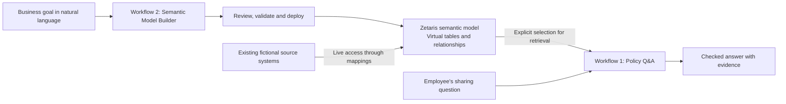
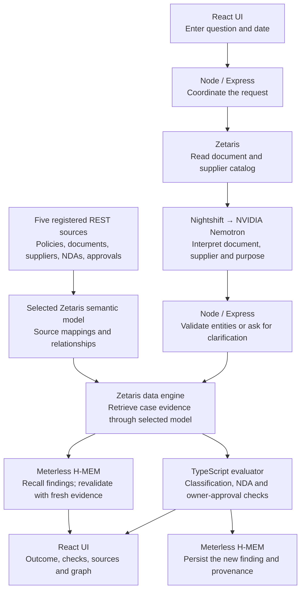
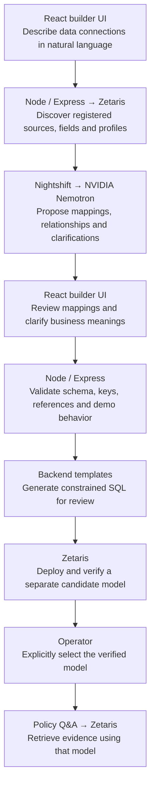

# ClauseLens

**Ask a policy question. Inspect the evidence. Understand what would change the answer.**

ClauseLens helps an employee understand whether they can share a document with an external supplier. Relevant facts often live in different places: a document registry, a policy repository, an NDA register and owner-approval records. Retrieving one relevant policy paragraph is not enough to establish permission.

The app interprets the employee’s question, retrieves connected evidence through Zetaris, applies explicit policy checks, and shows the result with its sources and an evidence graph. A second workflow lets a user describe data connections in natural language and build a reviewed semantic model on Zetaris for that retrieval.

This is a **fictional policy-assistance demonstration**. It sends no documents, grants no access and supplies no legal advice. All business records are fictional.

## Demo and submission links

Public URL fields are intentionally empty and will be filled in before submission. Localhost links work only on the machine running the app; they are not public judge-access links.

| Submission item | URL |
| --- | --- |
| Public live demo | |
| Google Drive — presentation video | |
| Google Drive — slide deck / supporting material | |
| Source repository | [GitHub](https://github.com/Balakrishnan-Ayyanar/genai-hackathon) |

| Local resource | Link |
| --- | --- |
| Workflow 1 — Policy Q&A | [localhost:3100](http://localhost:3100/) |
| Workflow 2 — Zetaris Semantic Model Builder | [localhost:3100/builder](http://localhost:3100/builder) |
| Selected semantic model and source mappings | [Local model metadata](http://localhost:3100/api/semantic-model) |

Submission videos, pitch decks, PDFs and generated media remain local and are excluded from this code repository. Public submission links above will be added later.

## Two workflows and their purpose

| Workflow | Purpose | User input | Output |
| --- | --- | --- | --- |
| **1. Policy Q&A** | Check a proposed sharing action against the supplied policy and available evidence. | Natural-language question and evaluation date; clarification when required. | Outcome, individual checks, source passages, missing facts or conflicts, and an evidence graph. |
| **2. Zetaris Semantic Model Builder** | Connect existing source fields into a consistent data model that Q&A can query. | Natural-language description of required data connections, based on a business goal. | Reviewed mappings, generated SQL and a separately deployed Zetaris semantic model. |

**How they connect:** the builder creates a semantic model on Zetaris. After the operator explicitly selects that verified model, Policy Q&A queries its virtual tables to retrieve evidence. A curated baseline model is already available, so answering a question does not require generating a new model each time. Deploying a candidate does not automatically select it.



A **semantic model** is the data mapping and relationship structure in Zetaris. A **language model** is NVIDIA Nemotron, reached through Nightshift, which interprets questions and proposes mappings. They serve different purposes.

## Workflow 1 — Policy Q&A architecture

**Purpose:** turn a sharing question into an inspectable, evidence-based result. The language model interprets the question; the fixed evaluator determines the outcome.



1. The employee asks a question. The app reads the live catalog through Zetaris, then asks the language model to identify the document, recipient and purpose. Unknown or ambiguous details require clarification.
2. The backend issues predefined, case-scoped SQL queries against the selected Zetaris model. Missing approval rows remain missing; opposing records and expired agreements remain visible to the evaluator.
3. Fixed rules check classification eligibility, NDA coverage for the supplier/purpose/date, and matching document-owner approval. The model cannot invent rules or override a failed check.
4. The UI shows the result, each check and supporting passages. Graph nodes and edges open the same source inspector, including source IDs, versions, effective dates and lineage.
5. Meterless H-MEM recalls prior case findings and revalidates them against the freshly retrieved original evidence. The new finding is then stored with provenance. A remembered hypothetical approval never becomes original approval evidence.

The four outcomes are **permitted under the supplied policy and evidence**, **not permitted because an explicit rule fails**, **insufficient information**, and **conflicting evidence requiring review**. The precedence is conflict → explicit failure → unknown → all checks pass.

An optional **Highlight key checks with AI** action asks the model to select relevant existing check IDs. The displayed explanations remain verified evaluator text; this action does not change the decision.

## Workflow 2 — Zetaris Semantic Model Builder architecture

**Purpose:** help a user build the data connections that evidence retrieval needs. For example: “Connect reports to their classifications, suppliers to their NDAs, and approvals to the correct report and recipient.”



Generation uses three model calls: a source/relationship blueprint followed by two field-mapping batches. The model proposes structured mappings; the backend generates SQL from controlled templates. Arbitrary model-generated SQL or SPARQL is not executed.

Review, validation, deployment and selection are separate steps. Validation checks allowed source fields, required relationships, keys and references, retained provenance, and the known demo policy cases. Changes invalidate prior validation; stale or changed proposals cannot deploy. Deployment creates a separate candidate and verifies seven tables and five relationships. The baseline and original source records remain intact.

This is a focused builder for the **five registered fictional sources and fixed ClauseLens schema**, not automatic ontology extraction from arbitrary enterprise systems or PDFs. See the [builder guide](clauselens/docs/SEMANTIC-MODEL-BUILDER.md) for validation and deployment details.

## How the integrations are used

### Zetaris — data virtualization and the semantic layer

Zetaris is the evidence-access engine for both workflows. Five curated JSON source systems are served through separate read-only REST endpoints and registered independently in Zetaris:

| Fictional source | Registered source | Semantic tables |
| --- | --- | --- |
| Document registry | `CL_DOCUMENTS` | `classification`, `document` |
| Supplier registry | `CL_SUPPLIERS` | `supplier` |
| Agreement register | `CL_AGREEMENTS` | `agreement`, `agreement_purpose` |
| Approval register | `CL_APPROVALS` | `approval` |
| Policy repository | `CL_POLICIES` | `policy_clause` |

The baseline Unified Semantic Layer (USL) is `lightning.metastore.clauselens.sharing_model`: **seven virtual tables and five foreign-key relationships**. Source-specific names such as `vendor_code` and `recipient_id` map to a common `supplier_id`. The app reads normalized columns through Zetaris rather than loading the legacy evidence fixture for live decisions.

The backend uses authenticated Zetaris REST SQL requests to `/api/v1.0/sql-editor/sqls/run`. Case retrieval uses seven explicit queries and records the selected model, query text, row counts, evidence hash and source lineage in its receipt. A source outage blocks retrieval; there is no silent fixture fallback.

This demonstrates **live data virtualization**: records remain in the source JSON systems, and Zetaris resolves the activated semantic mappings at query time. The five sources share one local server and represent independent business systems for this demo. A retrieval hash records the evidence read; it does not imply an atomic transaction across those sources.

The domain graph uses Document, Classification, Supplier, Agreement, PolicyClause, Approval and a user-entered SharingRequest. `agreement_purpose` normalizes NDA coverage. The inspectable graph is generated in the app as SVG; this MVP does not require Neo4j, RDF storage or SPARQL.

Implementation: [retrieval and model calls](clauselens/src/integrations.ts), [semantic mappings and queries](clauselens/src/semantic.ts), [registration/deployment SQL](clauselens/scripts/semantic/), [semantic-layer guide](clauselens/docs/SEMANTIC-LAYER.md).

### Meterless — Nightshift routing and H-MEM case memory

Meterless has two distinct integration roles:

- **Nightshift Runtime** runs on Windows and routes backend model requests to the configured provider. WSL reaches it through the local SSH tunnel. Requests use the OpenAI-compatible `/v1/chat/completions` endpoint, a server-side runtime token and `meterless-app: clauselens`. The configured route defaults to `meterless/auto`.
- **H-MEM Engine** stores and recalls previous case findings, including their evaluation source, evidence references, snapshot hash and simulation label. The app uses the official vendored TypeScript runnable reference and persists state in ignored `.runtime/hmem/`. Recall is case-filtered and revalidated against fresh evidence at the current evaluation date.

The H-MEM reference uses JSON persistence and deterministic hash embeddings for its reference ranking. It is **not a production memory service or a neural embedding integration**. No sleep/dream automation is enabled. Recall relevance scores never establish sharing permission.

Implementation: [memory adapter and revalidation](clauselens/src/memory.ts), [vendored reference](clauselens/vendor/hmem/reference/README.md), [upstream source](https://github.com/Meterless/Meterless/tree/main/engines/hmem/reference), [Apache-2.0 license](clauselens/vendor/hmem/LICENSE), [recorded upstream file hashes](clauselens/vendor/hmem/UPSTREAM-SHA256.txt).

### NVIDIA — language understanding and mapping proposals

NVIDIA contributes **Nemotron model inference**, routed through Nightshift:

| Model task | Contribution |
| --- | --- |
| Policy question interpretation | Extract the document, supplier and intended purpose from the question; backend catalog checks constrain the result. |
| Semantic-model generation | Propose source bindings, field mappings, relationships and clarification questions from registered metadata and the business goal. |
| Optional evidence focus | Select known check IDs to help the user inspect the existing decision. |

Recorded successful responses include `nvidia/nemotron-3-ultra-550b-a55b` and `nvidia/nemotron-3.5-super-vl-120b-a12b`. Routing can vary: the actual reported model is retained in interpretation/proposal receipts. An advertised catalog entry alone does not prove provider access. NVIDIA model calls are real; local GPU inference or training is not claimed.

Nemotron does not grant sharing permission, create source approval records, or run unrestricted queries. It assists interpretation and modeling; the backend validates its outputs and the fixed evaluator determines policy outcomes.

## Two-minute Q&A demo

1. Use the supplied date **2026-10-22** and ask: **“Can I share Project Orion’s design report with Supplier A for technical review?”**
2. Click **Ask ClauseLens**. The answer is **Permission isn’t established yet**: classification and NDA pass, but no matching owner approval is recorded. An absent record does not prove approval never happened.
3. Inspect a check, then click a report node or relationship in the evidence graph to reveal the original record and provenance.
4. Click **Simulate owner approval**. This feature was added **for demonstration purposes** to show which missing evidence would change the answer. It adds a clearly labeled hypothetical record to an in-memory copy, reruns the same checks, and shows **Permitted under the supplied policy and evidence**. It writes no source approval and grants no access.
5. Restore original evidence. The answer returns to insufficient information. Open **Case memory** to see earlier findings recalled and revalidated; a remembered simulation remains excluded from original evidence.

Use the separate **Build the semantic layer** tab to demonstrate the modeling workflow. Model generation may take time and consume provider quota; it is not required for each Q&A run.

## Pre-existing components and project-specific work

| Pre-existing component | How it is used / attribution |
| --- | --- |
| Zetaris installation and getting-started tooling | Existing Docker services and supplied setup/SQL utilities. Installation bundles and the private environment file are excluded from Git. |
| Meterless Nightshift Runtime | Existing Windows runtime and provider configuration; ClauseLens adds authenticated backend calls and WSL connectivity helpers. |
| Meterless H-MEM runnable reference | Upstream source and conformance suite reused unchanged under Apache-2.0. ClauseLens adds the memory adapter, case filtering and fresh-evidence revalidation. |
| NVIDIA Nemotron models | Existing hosted models accessed through the configured provider. No model training or fine-tuning was performed for this demo. |
| React, Express, TypeScript, Vite, Zod and Playwright | Existing application and test libraries; dependencies and pinned resolutions are in the application package manifest and lockfile. |
| Remotion, FFmpeg and ElevenLabs | Existing video composition, export and narration services/tools. These create submission media and are not part of the Q&A runtime. |
| Generated introduction clips | User-supplied AI-generated illustrative workplace scenes. They are labeled separately from actual app recordings; their audio is replaced with ElevenLabs narration. |

ClauseLens-specific work includes the two-workflow UI, fictional policies and records, fixed policy evaluator, semantic source mappings and SQL, reviewed model builder, evidence graph, simulations, provenance receipts, H-MEM revalidation, integration adapters and tests. The sources are curated structured facts linked to source text; arbitrary PDF extraction is outside the MVP.

Development was performed with **Codex**. No Cursor use is claimed. Live integration demonstrations use actual services; automated failure/alternate-state tests use explicitly labeled test doubles where documented. See the [implementation and tool-use record](clauselens/docs/IMPLEMENTATION.md) and [browser verification record](clauselens/docs/BROWSER-VERIFICATION.md).

## Run locally

Prerequisites: **Node.js 22+**, npm, the existing Zetaris Docker stack in WSL, and Windows Nightshift with a configured provider. Complete the [application setup and source-registration instructions](clauselens/README.md) first. The private configuration normally lives at `zetaris-getting-started/.env.local`; the backend can use another path through `CLAUSELENS_ENV_FILE`.

```bash
# From the repository root; start the existing Zetaris stack.
cd zetaris-platform
docker compose up -d
cd ../clauselens
npm ci
npm run build
npm start
```

Open [Policy Q&A](http://localhost:3100/) or the [Semantic Model Builder](http://localhost:3100/builder). The current tunnel helper targets the original Windows/WSL development machine and needs path/user adjustments on another machine. Installation directories are local prerequisites, not repository contents. Source registration depends on the Docker driver reaching the app’s source endpoints; see the [deployment guide](clauselens/docs/SEMANTIC-LAYER.md) before changing that setup.

Credentials remain server-side and out of frontend code, Git, screenshots and logs. The local demonstration has no login or multi-user isolation and is not a production-hosted service. A public demo needs deployment/access configuration before a public link can be supplied.

## Verification

```bash
cd clauselens
npm test
npm run test:hmem
npm run build
# Requires the running app, Zetaris and Nightshift; uses provider quota:
npm run verify
npm run test:browser
# Optional: generate a real mapping draft without deploying it.
npm run verify:builder
# Run separately: briefly changes and restores a fictional source label.
npm run verify:semantic
```

Previously recorded verification includes **40 application tests**, **13 upstream H-MEM conformance assertions**, and **17 selected desktop/mobile browser checks**, with an intentional duplicate-model skip. Browser coverage includes real Q&A, source inspection, graph clicks, approval simulation/reversal, ambiguity and memory revalidation. A separate real builder recording demonstrated generation, review, validation, deployment, selection and Q&A retrieval, followed by baseline restoration. These are recorded results, not a claim that this README edit reran the integration suite. Mobile testing uses Chrome emulation, not physical devices.

## Repository map

- [`clauselens/`](clauselens/): app, fictional data, tests and operational instructions.
- [`clauselens/data/sources/`](clauselens/data/sources/): original fictional source records and passages.
- [`clauselens/docs/SEMANTIC-LAYER.md`](clauselens/docs/SEMANTIC-LAYER.md): registrations, mappings, relationships and live virtualization.
- [`clauselens/docs/SEMANTIC-MODEL-BUILDER.md`](clauselens/docs/SEMANTIC-MODEL-BUILDER.md): focused model generation and review/deployment gates.
- [`clauselens/docs/IMPLEMENTATION.md`](clauselens/docs/IMPLEMENTATION.md): integration evidence, limitations and actual tool use.
- [`clauselens/docs/BROWSER-VERIFICATION.md`](clauselens/docs/BROWSER-VERIFICATION.md): browser checks and real-versus-mocked boundaries.
- [`connection-tools/`](connection-tools/): WSL/Windows connectivity helpers.
